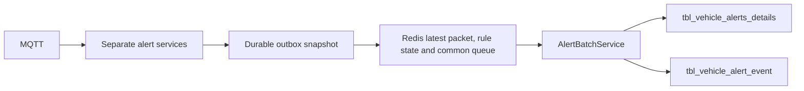

# Paddy GPS alert service

This worker follows the L2 alert architecture for the Paddy database: separate
alert services, repositories, Redis latest-packet/rule state, a common Redis
alert queue, alert details, and event start/progress/end records.

**Excluded:** Quantity Deviation (`DA`), Wrong Entry (`WE`), Geo Fencing (`GF`)
and District Deviation (`DIST_DEV`). All four are disabled in the master and
hard-excluded from generation. There are 16 master rows and 12 enabled types.
Existing historical records are retained.

## Structure

```text
gps_service.js                    Startup and graceful shutdown
src/
  config/                        MySQL, Redis, MQTT and shared alert/trip rules
  mqtt/subscriber.js             MQTT validation and durable acknowledgement
  jobs/alert.scheduler.js        Network gap, offline, disconnection and delay
  repositories/
    TripRepository.js
    AlertRepository.js           Master settings, outbox staging, details insert
    AlertEventRepository.js      Event open/progress/close insert/update
    AlertOutboxRepository.js     Durable queue delivery checkpoint
    AlertStateRepository.js      Redis state with existing-outbox recovery
    RedisRepository.js           Latest packets, rule state and common queue
    routeRepository.js
  services/
    packet.service.js
    alert.service.js             Rule dispatch and episode lifecycle
    AlertBatchService.js         Redis queue processing and SQL writes
    overspeed.service.js
    longHaltService.js
    route-delay.service.js       Off-route packet checks and delivery-delay scan
    searching-network.service.js
    connectivity.service.js      Online recovery and offline scan
    disconnected.service.js
    idle.service.js
    ignition.service.js          Ignition off/on transitions
  helpers/                       Alert lifecycle, packet time, coordinates and JSON
scripts/                         DB setup/check, verification and route import
test/
```

`paddy_trip` continues to handle shipment start/arrival transitions and GPS
history. This worker handles alerts. Run the two workers alongside each other
with distinct MQTT client IDs. Existing endpoint distances suppress halt/off-route
checks while loading/unloading; they never generate GF alerts.

## Alert notifications

Each saved alert creates one shared `tbl_notifications` row (title, message,
event_key, shipment reference, district and vehicle). The separate
`tbl_notification_details` table stores notification_id, user_id, user_source,
is_read/read_at and published_at for each recipient. Content is not copied for
each user. Event keys and recipient unique keys prevent duplicate rows and retries
do not reset read state.

Recipients follow the shipment route. PACS/LAMPS to Miller alerts go to active
main-backend State users (user_type=2) plus active Paddy MILLER accounts whose
facility_id matches that shipment's Miller facility (legacy miller_id-only
accounts are supported too; conflicting links are excluded). Miller to Godown/FCI alerts additionally go to
active destination receiving users (core user_type 4/8) with an active assignment
to that exact core store and destination district. District-only DM assignments,
other Millers, unrelated stores and inactive users are excluded. Both flows also
notify the active DRIVER user referenced by shipments.driver_user_id. Other
drivers at the same facility are excluded; driver name/phone alone are not used
to guess an account.
CORE_DB_* settings configure the core read connection. user_source=CORE/PADDY
prevents equal numeric IDs from colliding. Recipient caching is per shipment,
not per district. A Godown requires core_store_location_id on the shipment or
core_store_id on the destination facility; missing mapping never picks a random
store. State and Miller still receive the notification if that mapping is absent.
`npm.cmd run verify:recipients` checks both flows using temporary SQL fixtures.
`npm.cmd run notification:check` reports current running-trip recipients and
missing Miller/store/user mappings. New alert processing also logs
NOTIFICATION_RECIPIENT_MISSING with the specific reason instead of silently
omitting a required recipient. No substitute account or unrelated store is chosen.

Alert details, notifications, recipient rows and the outbox completion marker
commit together. After commit, the worker publishes each pending recipient to
Redis channel `paddy:notification:new`. A failed publish leaves published_at NULL
for retry. Consumers should deduplicate using delivery_id; a Redis publish is not
an acknowledgement that a device received or read the message. A Paddy socket
consumer must subscribe to that channel to display real-time notifications.
It deliberately does not publish Paddy notification IDs into the core channel.
No external app message is sent by DB verification; temporary notification rows
are rolled back. Historical processed alerts are not broadcast again.

## Setup

Node 24, the existing Paddy MySQL/MariaDB database, Redis and MQTT are required.
The local `.env` is configured from existing Paddy DB/MQTT/Redis settings and is
ignored by Git. For another deployment, copy `.env.example` and configure it.

```powershell
cd D:\jsfc_vts\paddy_setup\paddy_gps_service
npm.cmd ci
npm.cmd run db:setup
npm.cmd run check:db
npm.cmd start
```

`db:setup` runs the adjacent `Paddy-backend/scripts/migrate.js` using this service's
loaded `DB_*` settings. Migration **046** renames the old details table while
preserving its data and creates event/outbox tables. Migration **047** removes
`vehicle_id` from both details and events and adds per-alert metrics. Migration **048** removes the event path column. Vehicle identity is resolved through `shipment_id` and `vehicle_no`.
For container deployment,
run migrations from the backend/host before starting the worker; external DB,
Redis and MQTT hosts must be reachable from the container.

It also inserts missing alert-master defaults without replacing existing timings.
Startup/readiness reject missing or mismatched master IDs. Keep the MQTT client ID
distinct from paddy-trip and paddy-lastLocation. Local `.env` is ignored by Git.

Configure:

- `DB_*`: existing Paddy write database and optional TLS CA.
- `REDIS_URL`: existing Redis connection.
- `PADDY_ALERT_REDIS_PREFIX`: defaults to `paddy:gps:alerts`, isolated from L2/trip keys.
- `MQTT_URL`, optional username/password/CA, unique stable `MQTT_CLIENT_ID`.
- `SCAN_INTERVAL_SECONDS`: 60; time-based alert evaluation interval.
- `ALERT_BATCH_INTERVAL_SECONDS`: 5; queue flush interval.
- `ALERT_BATCH_SIZE`: 500; jobs handled per flush.
- `GPS_MAX_PACKET_GAP_MINUTES`: 5; longer gaps reset sustained motion evidence.

Publish with QoS 1 or higher for redelivery support. Invalid packets are
acknowledged and discarded. Infrastructure failures retain committed work for
recovery. The worker drains active processing and flushes the queue on shutdown.

## Data flow and tables



| Table | Purpose |
| --- | --- |
| `gps_alert_master` | Alert configuration with audit columns and status |
| `tbl_vehicle_alerts_details` | Detail messages; renamed from `shipment_gps_alerts` |
| `tbl_vehicle_alert_event` | Event start/end, duration, coordinates and route distance |
| `gps_alert_outbox` | Durable jobs and state snapshots before MQTT acknowledgement |
| `shipment_routes` | Actual GeoJSON route used by the off-route service |

Paddy uses `shipment_id` for trip identity. Detail rows link to their event with
`alert_event_id`. A sustained condition opens one event at its configured threshold.
Subsequent packets update that event's duration/location. Recovery closes it;
an additional episode opens a new event. Reminder details link to the same event.
Online/ignition-on are instantaneous, closed conditions. Event `status=1` means
the condition remains open, `status=0` means recovered or trip-finished.
Event end_date_time is the alert's own recovery time, even while the vehicle
continues its trip. Offline ends on fresh communication, overspeed on normal
speed, halt on movement, and off-route on returning to the route. Trip completion
at the destination geofence is separate (shipments.trip_completed_at). It only
finishes unresolved alert episodes and never replaces existing recovery times.
duration_minutes tracks the alert episode. Old progress cannot reopen a closed
condition. `npm.cmd run verify:completion` tests both lifecycles in temporary tables.
Progress SQL updates only an open event (status=1 and end_date_time IS NULL).
After recovery, replayed or later progress for that same episode cannot change
its duration, speed, coordinates or recovery timestamp.
Detail `status` remains its reporting status. SQL timestamps are UTC.

Both details and events store `duration_minutes` and `ignition_status`.
Type-specific fields are `long_halt_minutes`, `idle_minutes`,
`network_gap_minutes`, `offline_minutes`, `disconnected_minutes`,
`ignition_off_minutes`, and `delay_minutes`. Delay duration starts at the planned
completion time. Existing `speed` and `off_route_in_km` fields cover overspeed and
route alerts; events also retain `max_speed`. Start/end coordinates remain available.
Online and ignition-on use instantaneous events with ignition status/location.

Each outbox job contains the updated state snapshot and commits before acknowledgement. Batch delivery stores
Redis data, claims queue items into a processing list, and writes event changes,
details and the job completion marker in one SQL transaction. Redis items are
acknowledged after commit. A unique detail/event key prevents duplicates on
replay. Pending processing items are recovered under a renewable writer lock.
SQL outbox jobs rebuild the queue after Redis loss. Retain pending jobs and the
latest state snapshot per shipment when defining an outbox retention policy.

Redis stores:

- `<prefix>:latest:<vehicle>`: latest normalized packet, protected from older data.
- `<prefix>:state:<shipment_id>`: combined condition state and revision.
- `<prefix>:condition:<shipment_id>:<code>`: individual sustained-alert state.
- `<prefix>:vehicle_alert_queue`: common queue of jobs with alerts/events.
- `<prefix>:vehicle_alert_processing`: jobs currently being written.

Redis state is used when its revision matches the latest committed outbox snapshot.
Missing/lagging Redis state is restored from that existing snapshot. Shipment row
locks serialize evaluation; READ COMMITTED transactions read the latest snapshot
without locking the batch writer's job. Queue recovery prevents duplicate delivery.

## Location and column usage

Shipment and alert location use district_id. Block columns were removed from
alert details/events by migration 095. New queue payloads and SQL inserts contain
only district metadata. Older queue payloads remain processable because unused
legacy fields are not inserted into the current tables.

Duration, speed, ignition and per-type metrics are populated by the worker for
applicable alerts; unrelated per-type fields remain NULL. Detail metrics are a
snapshot at message creation; event metrics update throughout the episode.
Legacy geofence, in_out_status and deviation_quantity_kg fields are retained for
historical compatibility but are not populated by the 12 enabled alert types.
The created_by field is nullable for worker-generated records. Migration 053 removes the unused notification send fields.

## Supported alerts

| ID | Code | Trigger |
| --- | --- | --- |
| 2 | LH | Speed <= 1 kph outside endpoints, alerts at alert_time and 2 x alert_time minutes |
| 3 | DO | No fresh live packet for 30 minutes after dispatch |
| 5 | OR | Increasing route deviation reaches configured metre milestones, currently 200/500/1000 |
| 6 | DD | Expected completion passed before GPS arrival |
| 7 | OS | Speed > alert_time km/h, currently 50, immediate once until speed recovers |
| 8 | SFN | Ten-minute live-packet gap or sustained explicit network searching |
| 9 | DISC | No fresh live packet for 1,440 minutes |
| 12 | IDL | Ignition on, speed < 1 kph for alert_time minutes, currently 10 |
| 13 | IGN_OFF | Explicit ignition-off state |
| 14 | IGN_ON | Explicit transition from ignition off to on |
| 15 | ONL | Fresh telemetry after an emitted SFN/DO/DISC alert |
| 16 | ON_ROUTE | Returns within the route threshold after an emitted Off Route alert |

Alert configuration follows the reference GpsService and is read from gps_alert_master:

- OS: alert_time is a positive speed limit in km/h, not a duration.
- OR: alert_time, alert_reminder_time and alert_interval are successive distance milestones in metres. At most three alerts are sent, and distance must increase between alerts. Returning below the first milestone closes the episode.
- All three Off Route details link to one Off Route event. While off-route, duration/distance update that event. Recovery adds one On Route detail linked to the same closed event, without inserting a separate On Route event. Repeated on-route packets add nothing. A later departure creates a new episode and resets its milestone count.
- LH: alert_time must be positive minutes. Exactly two notifications occur at T and 2T, with event progress updates between them.
- IDL, SFN, DO and DISC: alert_time must be positive minutes. A zero/invalid setting suppresses the condition. One notification is sent until recovery.
- IGN_OFF: alert_time is a nonnegative minute duration. Zero/null permits an immediate alert. IGN_ON remains a transition notification.
- DD is a Paddy-specific ETA condition using alert_time in minutes. It emits once per continuous delay episode and updates that event's duration on subsequent scans, even if a legacy reminder value remains configured. Migration 098 clears its reminder fields. On-route recovery is a separate OR/ON_ROUTE lifecycle and does not cancel an overdue ETA.

No alert threshold environment variables or separate speed/distance defaults are used. Migration 092 copies the reference master's current values by alert code, preserving Paddy's distinct numeric IDs and excluded types. The GpsService source/database is read only during this one-time alignment, not at worker runtime. Further configuration changes are read from the Paddy table. `status=0` disables a type.

No-fix packets cannot assert motion, halt or route position. Missing ignition
is unknown. Historical packets do not recover the live-device offline clock.
SFN is a communication-gap warning, not a cellular diagnosis. Notification storage and Redis delivery follow the recipient flow described above.

Fresh, non-retained LGN/HEL/HBT packets also count as device communication after
vehicle/IMEI mapping validation. Their recent server_date_time updates only the
communication clock and closes network/offline/disconnected episodes, with an
Online recovery notification where applicable. They do not update GPS position,
speed, ignition, trip start or the PVT packet watermark. Historical/stale/retained
presence packets cannot mark a device online. Redis position cache remains PVT-only.
Event-table coordinates are not stored: start/end latitude/longitude columns
were removed in migration 097. Alert-detail coordinates and GPS processing remain
available for route and location rules.
Event progress ordering uses the episode's monotonic duration; the redundant
last-sample column is not stored. Notifications link alerts by event_key.

For an already-running shipment with missing dispatch/start timestamps and no
processed live packet, communication monitoring initializes once from the latest
valid persisted trip/creation/GPS timestamp. This fallback does not populate trip
start or ETA, reset lastLiveAt, or advance an existing outage clock on restart.
Source-device last GPS timestamps may seed that initial clock even when no valid
coordinates are available. IMEI mismatches for running-trip packets are logged
explicitly so an incorrect device mapping cannot remain silent.

## MQTT payload and route

Publish on `gps/JH01AB1234/data`:

```json
{
  "packet_header": "$PVT",
  "vehicle_number": "JH01AB1234",
  "imei_no": "123456789012345",
  "packet_type": "L",
  "gps_fix": "1",
  "date_time": "24102026 100000",
  "latitude": 23.5,
  "longitude": 85.5,
  "speed": 60,
  "ignition_status": "1"
}
```

The vehicle must be registered with an active GPS/IMEI mapping. A payload vehicle
number must match the topic; a supplied IMEI must match the mapped device.
Confirmed Paddy UTC `DDMMYYYY HHmmss` takes precedence over upstream epoch time.
ISO `gps_at` with timezone and epoch seconds/milliseconds are also supported.
`H`/`HISTORY`, `is_history=1`, or `is_live=0` indicate historical telemetry.
Optional `searching_network` or `network_status: "SEARCHING"` supplies explicit
network-search telemetry. Both PADDY and CMR running shipments are supported.

Off-route detection requires the real route, not a straight line between stores:

```powershell
npm.cmd run geometry:set -- route 123 .\route.geojson
```

Use a real shipment ID and GeoJSON LineString/Feature, longitude first.
The old district-boundary table/column are retained for existing data and are
not read or imported by this worker.

## Reports and verification

Restart the **paddy** backend for these authenticated APIs:

```http
GET /api/v1/gps-alert-masters
GET /api/v1/reports/gps-alerts?shipment_id=123
GET /api/v1/reports/gps-alert-events?shipment_id=123&status=1
```

Optional filters: `shipment_id`, `vehicle_id`, `alert_id`, `season_id`,
`facility_id` (source), `miller_id`, `district_id`, `status`, ISO `from`, exclusive `to`.
PACS/LAMPS, Miller and transporter reports retain their shipment scope.
ADMIN/OPERATOR may view all. Miller reports require dashboard view permission.
Event time filtering uses `start_date_time`; detail filtering uses `last_date_time`.
The `vehicle_id` report filter remains supported through `shipments.vehicle_id`;
it is not duplicated on the alert tables.
In **paddy/postman/SFC_CMR.postman_collection.json**, use folder **17** and set
`gps_report_token` to the desired role's login token.

```powershell
npm.cmd test
npm.cmd run check:db
npm.cmd run verify:db
```

`verify:db` requires an existing shipment and Redis. It uses a temporary isolated
Redis prefix and a rolled-back SQL transaction to verify queue recovery,
deduplication, latest packet/rule state, detail-event links, event duration
updates, and event closure. It cleans up its own Redis keys afterward.

Alert eligibility requires shipments.trip_status=1 and shipment status DISPATCHED/IN_TRANSIT. Vehicle active flags do not gate alert generation. TripRepository resolves the vehicle from the running shipment, verifies its GPS/IMEI mapping, and manages vehicle/shipment row locks. Packet processing and scheduled generation enforce the same rule. Other shipments are scanned only to close existing events and clear pending condition state; they do not create new alerts.

Shared flow: config/alerts.js defines running-trip conditions and excluded alerts. helpers/alert-lifecycle.js owns event start/progress/end, threshold timers and reminder deduplication. Packet and scheduler paths both call processShipment in services/packet.service.js to load state, evaluate rules and stage the result.

Shipment date display: migration 052 converts shipment operational datetime fields to TIMESTAMP under a UTC session, preserving existing instants. The backend, trip worker and alert service use UTC sessions. phpMyAdmin using the server IST session displays the original shipments table in IST. Nullable completion/arrival fields remain NULL. Timestamp values must fit the database-supported TIMESTAMP range; existing values were checked before migration. The shipments_ist view remains an explicit IST display independently of session timezone.

Only one instance per Redis namespace and MQTT_CLIENT_ID can start. A renewable Redis service lease rejects another start with SERVICE_ALREADY_RUNNING before it connects to MQTT. An expired/lost lease stops the worker; an abrupt stop releases ownership after at most 10 seconds. Use a distinct MQTT client ID for each intentionally separate worker. ALERT_BATCH_WRITTEN jobs are successful queue processing, and PACKET_IGNORED records represent rejected telemetry rather than a connection failure.

Migration 054 preserves the previous state in processed outbox snapshots and drops the old dedicated state table. No separate state table is required. Completed-trip cleanup reads the latest outbox conditions and open alert events.

Service control commands: npm.cmd run restart gracefully stops the existing instance through Redis and starts a replacement in the current terminal. npm.cmd stop stops it, and npm.cmd run service:status shows the running PID. These work for both background and terminal instances without Windows process-kill permissions. The old service.pid file is no longer used.

Scheduled alerts with no packet/state coordinates use the last valid known position from the service Redis cache or mapped GPS device, only if its GPS time is not in the future. This seeds location only and does not change lastLiveAt, packet watermark or offline timers. Migration 056 backfills missing historical coordinates only where the known GPS fix predates the alert/event timestamp. These are last-known positions, not fresh readings.

`npm.cmd start` now uses the same stop-then-start controller as restart, so a leftover background instance or stale lease is handled automatically. Ctrl+C is forwarded to the worker over IPC, and worker shutdown also runs if its controller disconnects. No service is intentionally left running after start/stop verification.

Migration 057 renumbers existing event IDs in order and preserves detail links through ON UPDATE CASCADE. Existing events are updated directly; INSERT runs only for a new episode, so progress updates do not consume auto-increment IDs. Verification uses session-only temporary copies of event/details/outbox tables and does not advance production counters. Auto-increment may still have gaps after a failed real insert or rollback.

Migration 065 adds ON_ROUTE recovery. Returning to the saved polyline closes the off-route episode and emits one recovery notification. Missing GPS fix or geometry does not prove recovery. The route distance limits are now the OR row's alert_time/alert_reminder_time/alert_interval values, as in GpsService.
